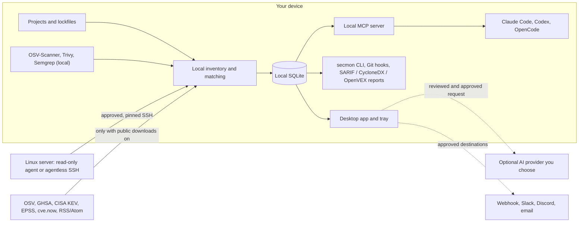

<p align="center">
  <picture>
    <source media="(prefers-color-scheme: dark)" srcset="docs/assets/logo-dark.png">
    
  </picture>
</p>

<h1 align="center">Security Monitor</h1>

<p align="center"><strong>You fixed it in the repo. Is production still vulnerable?</strong></p>

<p align="center">
  <a href="https://github.com/umitaltinozzz/security-monitor/actions/workflows/ci.yml"></a>
  <a href="LICENSE"></a>
  
  <a href="https://umitaltinozzz.github.io/security-monitor/"></a>
</p>

<p align="center"><a href="README.tr.md">Türkçe</a></p>

<p align="center">
  
  <br><sub>Demo recorded from the desktop UI with sample data (lodash 4.17.20, GHSA-35jh-r3h4-6jhm); no real scan or server.</sub>
</p>

Security Monitor (`secmon`) is an open-source, local-first security monitor for your projects and your Linux servers. It matches your dependencies against vulnerability advisories on your own machine, then checks what is actually running in production, so a fix that never got deployed does not look finished.

No account. No cloud dashboard. Source code, lockfiles, and inventory stay on your device unless you approve a specific transfer.

> **Status: pre-release.** v1.0 is code complete; signed installers are not published yet. Build from source to try it. Missing, stale, or unverified data is always shown as *could not verify*, never as safe.

## What it does

- **Finds vulnerable dependencies locally.** Lockfile inventory, offline OSV data, GHSA, CISA KEV and EPSS, plus OSV-Scanner, Trivy, and Semgrep adapters.
- **Compares the repo with production.** A read-only Linux agent (or agentless SSH) reports what is installed and running, including kernels that need a reboot and processes still using deleted libraries.
- **Warns before vulnerable code is pushed.** `secmon hook` checks only the changed lockfiles, offline, in under three seconds.
- **Works with your coding agent.** One command connects Claude Code, Codex, or OpenCode to a local MCP server and Security Monitor skills.
- **Prepares fixes you approve.** Fixes are prepared in an isolated Git worktree and tested in a network-disabled sandbox; nothing is applied without your approval.

## Why it is different

| | Security Monitor | Typical SaaS scanners | Repository scanners (Dependabot, OSV-Scanner, Trivy) |
| --- | --- | --- | --- |
| Account required | No | Yes | Varies |
| Source code leaves your device | Only with explicit approval | Usually | No |
| Sees what runs on your servers | Yes, read-only | Some, with cloud agents | No |
| "Fixed in repo, still running in production" | Yes | Rarely | No |
| Missing data shown as safe | Never | Varies | Varies |
| Cost | Free, Apache-2.0 | Paid tiers | Free |

Security Monitor uses OSV-Scanner, Trivy, and Semgrep as local adapters; it builds on them rather than replacing them.

## How it works



The agent has no remote-command feature: it runs only a fixed, compile-time list of read-only collectors and never needs root.

## Privacy: what leaves your device

| Data | Leaves the device? |
| --- | --- |
| Source code, lockfiles, project inventory | No, unless you approve a specific AI request or export |
| Server inventory | Moves from your server to your device over a pinned SSH connection, after you approve each collection |
| Advisory and feed updates | Only when public downloads are enabled; OSV requests name the ecosystem, not your packages |
| AI requests | Only after you review the redacted prompt, destination, tools, and cost limit; budgets default to zero |
| Secrets (SSH keys, API keys, webhooks) | Stored only in the OS credential store |
| Telemetry | None |

See [Privacy](docs/privacy.md) for the full model.

## Quick start (from source)

Install Rust, Node.js 22 or newer, pnpm 10.27.0, and the [Tauri prerequisites](https://v2.tauri.app/start/prerequisites/).

```text
pnpm install --frozen-lockfile
pnpm -C apps/desktop tauri dev
```

CLI:

```text
cargo run -p secmon -- scan <project-path> --offline
cargo run -p secmon -- report --format sarif
cargo run -p secmon -- hook install --pre-push --mode warn
cargo run -p secmon -- integrate claude-code --dry-run
```

Linux agent: build the static binary, verify its checksum, and install it with the provided script. Confirm the SSH host-key fingerprint independently before pairing. See [Linux agent installation](docs/agent-install.md).

## With coding agents

```text
secmon integrate <claude-code|codex|opencode> --dry-run
secmon integrate <claude-code|codex|opencode>
secmon integrate remove <claude-code|codex|opencode>
```

This adds the local MCP server, the Security Monitor skills, and, where supported, a hook that runs `secmon hook run` before the agent pushes. `--dry-run` shows the exact diff, and `remove` restores the previous files. Agents can read findings and leave notes; they cannot change a finding's status or priority. See [Coding-agent integrations](docs/integrations.md).

## Screenshots

<p align="center">
  
</p>

<details>
<summary>More screens (light and dark)</summary>

| Screen | Light | Dark |
| --- | --- | --- |
| Findings |  |  |
| Projects |  |  |
| Servers |  |  |
| History |  |  |
| Settings |  |  |

</details>

Screenshots come from the deterministic test fixture, not a real scan or server.

## Documentation

Full documentation: **[umitaltinozzz.github.io/security-monitor](https://umitaltinozzz.github.io/security-monitor/)**

- Using it: [CLI](docs/cli.md) · [Linux agent installation](docs/agent-install.md) · [Coding-agent integrations](docs/integrations.md) · [AI providers](docs/ai-providers.md) · [Local MCP](docs/local-mcp.md) · [Shared local memory](docs/shared-memory.md)
- How it works: [Architecture](docs/architecture.md) · [Scanner adapters](docs/scanners.md) · [Finding correlation](docs/correlation.md) · [Repository-to-production drift](docs/drift.md) · [Deploy ID](docs/deploy-id.md) · [Scan orchestration and notifications](docs/orchestration.md)
- Trust: [Privacy](docs/privacy.md) · [Threat model](docs/threat-model.md) · [Data sources](docs/data-sources.md) · [Signed releases and updates](docs/release.md) · [Performance budgets](docs/performance.md)

## Contributing and security

Read [CONTRIBUTING.md](CONTRIBUTING.md) before making changes. Use the issue forms for bugs, feature requests, and false-positive reports, and [Discussions](https://github.com/umitaltinozzz/security-monitor/discussions) for questions, setups, and ideas. Report vulnerabilities privately as described in [SECURITY.md](SECURITY.md), not in a public issue.

## License, data, and disclaimer

Source code is licensed under [Apache-2.0](LICENSE). Vulnerability and advisory data keep their own source licenses; see [Data sources](docs/data-sources.md). cve.now summaries are attributed to [cve.now](https://cve.now/) under [CC BY 4.0](https://creativecommons.org/licenses/by/4.0/). This product uses data from the NVD API but is not endorsed or certified by the NVD.

A missing finding is not proof that software or an environment is secure. Verify results against the original advisory and your own environment before making security decisions.
