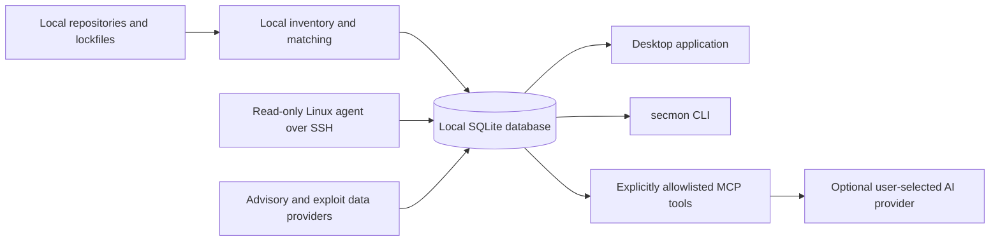

# Security Monitor

Security Monitor (`secmon`) is an open-source project for local-first security monitoring of software projects and deployed environments. Its goal is to connect dependency advisories with deployment evidence while keeping source code, lockfiles, and inventory on the user's device by default.

> **Current state:** this repository is under active development. The current release contains the Rust workspace, typed core and SQLite data layer, a desktop shell, and a CLI that reports its version. Dependency inventory, vulnerability matching, scanners, agents, AI workflows, and the product UI are roadmap work; do not use the current build as a security scanner or as evidence that a system is safe.

## Implemented today

- Cargo and pnpm workspaces with cross-platform CI.
- Rust domain types, SQLite migrations, typed repositories, and generated TypeScript contracts.
- A Tauri desktop shell and the `secmon --help` / `secmon --version` CLI.

These are engineering foundations; they do not yet monitor a project or production environment.

## Roadmap

The planned v1.0 scope adds local inventory parsing, advisory matching and provenance, scanner adapters, finding correlation, read-only Linux collection over SSH, optional approved AI workflows, and usable desktop/CLI management flows. Work proceeds milestone by milestone, and these features will be described as they become available.

## How it compares

Dependency update bots help propose version changes. Lockfile scanners focus on known vulnerable packages. Container and host scanners inspect deployed software or configuration. Security Monitor's planned difference is to connect local project inventory with read-only deployment evidence, advisory provenance, and user-controlled triage in one local workflow. That integration is not implemented yet; current functionality is limited to the engineering foundations listed above.

## Planned architecture



The diagram describes the target product architecture, not features available in the current build. The Linux agent, providers, matching engine, MCP tools, and functional UI are not implemented yet.

## Privacy

Security Monitor is designed to keep project source, lockfiles, and inventory local by default. The current application shell and CLI do not upload them or make runtime network requests. Future provider and AI features must use the approval and privacy controls described in [Privacy](docs/privacy.md); no upload of source, lockfiles, or inventory is planned without explicit recorded approval. Optional AI is planned for advisory metadata, with credentials kept in the operating system credential store.

## Quick start

### Desktop shell (development)

Install Rust, Node.js 22 or newer, pnpm 10.27.0, and the native prerequisites listed in the [Tauri guide](https://v2.tauri.app/start/prerequisites/). Then run:

```text
pnpm install --frozen-lockfile
pnpm -C apps/desktop tauri dev
```

This launches the current desktop shell; project monitoring screens are not implemented yet.

### CLI

Install the Rust toolchain from `rust-toolchain.toml`, then run:

```text
cargo run -p secmon -- --help
cargo run -p secmon -- --version
```

The current CLI only provides its version and help output. Scan and management commands are planned.

### Linux agent

The read-only Linux server agent is not implemented yet. See [Linux agent installation](docs/agent-install.md) for its planned trust boundary. There is no agent install command to run in this version.

### AI providers

AI provider integration is not implemented yet. See [AI providers](docs/ai-providers.md) for the planned privacy and approval model.

## Data sources and attribution

No advisory data is fetched by the current application. Planned sources and their intended roles are documented in [Data sources](docs/data-sources.md). The application must retain source attribution and must not treat missing, stale, or unverified data as a clean result.

If a future version displays cve.now summaries, those summaries are licensed under [CC BY 4.0](https://creativecommons.org/licenses/by/4.0/) and require attribution to [cve.now](https://cve.now/). Data combined by cve.now may have separate source terms. For any NVD-derived data, the required notice is: “This product uses data from the NVD API but is not endorsed or certified by the NVD.”

## Documentation

- [Architecture](docs/architecture.md)
- [Threat model](docs/threat-model.md)
- [Privacy](docs/privacy.md)
- [Data sources](docs/data-sources.md)
- [Linux agent installation](docs/agent-install.md)
- [Deploy ID](docs/deploy-id.md)
- [AI providers](docs/ai-providers.md)
- [CLI](docs/cli.md)
- [Contributing](docs/contributing.md)

The documentation site source is in [`docs/site`](docs/site). A GitHub Pages workflow builds it and deploys only when Pages is enabled by a repository maintainer.

## Contributing

Read [CONTRIBUTING.md](CONTRIBUTING.md) and [docs/contributing.md](docs/contributing.md) before making changes. Please use the issue forms for bugs, feature requests, and false-positive reports. Security vulnerabilities should be reported through the private process in [SECURITY.md](SECURITY.md), not a public issue.

## Security

See [SECURITY.md](SECURITY.md) for supported-version policy and private vulnerability reporting.

## License

Security Monitor source code is licensed under Apache-2.0. See [LICENSE](LICENSE). Third-party vulnerability and advisory data retain their own source licenses and terms.

## Disclaimer

Security Monitor is provided for informational purposes. A missing finding is not proof that software or an environment is secure. Verify results against the original advisory and your own environment before making security decisions.
