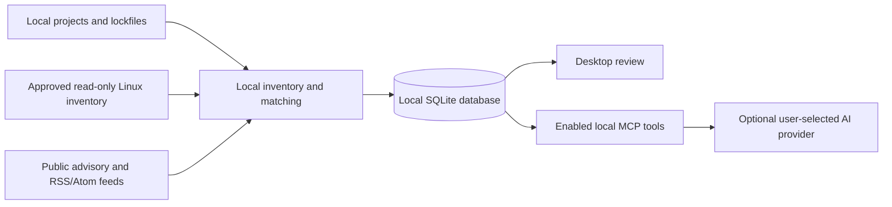
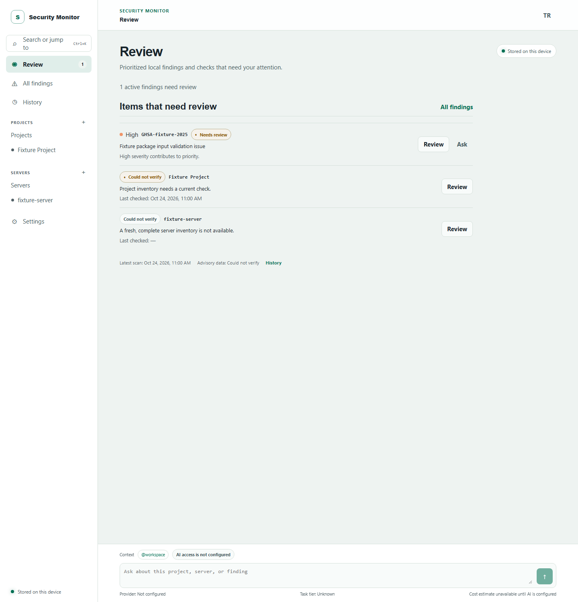

# Security Monitor

Security Monitor (`secmon`) is an open-source, local-first security monitoring product. The desktop app connects local project inventory, advisory matching, scanner adapters, finding review, and approved Linux server inventory in one workflow. Missing, stale, partial, or unverified evidence remains visible for review; an empty screen is not a claim that a system is safe.

## Why Security Monitor

A repository scan cannot show what is currently running after deployment. Security Monitor connects local repository evidence with separately approved, read-only Linux inventory so users can review that difference on their device.

| Tool | Main focus | How Security Monitor differs |
| --- | --- | --- |
| [Dependabot](https://docs.github.com/en/code-security/concepts/supply-chain-security/dependabot-security-updates) | Detects vulnerable dependencies in GitHub repositories and can open update pull requests. | Security Monitor keeps inventory and review local and adds approved production inventory; it does not automatically update dependencies. |
| [Trivy](https://trivy.dev/docs/latest/) | Scans packages, images, secrets, and configuration. | Security Monitor includes a Trivy adapter and connects scan evidence to locally reviewed deployment observations. |
| [OSV-Scanner](https://google.github.io/osv-scanner/) | Extracts project packages and matches them against OSV advisories. | Security Monitor uses offline OSV data and adds local finding review, advisory signals, and approved server inventory. |

## How it works



Local inventory and feed matching happen on-device. Remote AI use and source-file access require separate user approvals.

## Desktop workflow

- Add a local project folder or discover candidate projects, then start a quick or full scan. Inventory and scan results are stored locally.
- Review findings, filter the list, inspect evidence, and record a reasoned user disposition. User dispositions are kept in the audit history.
- Check scanner availability and install supported scanners only after enabling public downloads. Advisory data updates are also explicit user actions.
- Discover static SSH host configuration, verify a host fingerprint, pair a Linux server, and separately approve each inventory collection. SSH credentials use the operating-system credential store.
- Review restart evidence when the installed kernel differs from the running kernel, processes retain deleted shared libraries, or allowlisted manually installed binaries are found under `/opt` and `/usr/local`. Missing permissions remain partial or unverified.
- See product-matched RSS/Atom security-news signals separately from vulnerability findings. Signals do not create findings by themselves and bind only when a matching advisory ID arrives.
- Switch between English and Turkish and light, dark, or system appearance. The app can stay in the system tray.

AI settings support user-configured OpenAI-compatible, Anthropic, and loopback-local providers. Before each request, the app shows the redacted prompt, provider origin, region, enabled tools, and a worst-case bounded cost estimate. Provider credentials stay in the OS credential store, budgets default to zero, and project provider permissions are checked again before sending. The local CLI MCP server exposes only enabled tools and requires a separate recorded per-project approval before reading source files. Supported coding-agent plugins can share redacted, expiring local notes; notes remain untrusted context, and agents cannot change finding status or priority.

## Screenshots

These screen captures were generated by the deterministic desktop E2E fixture. They illustrate the interface and do not represent a real scan or server.

| Screen | Light | Dark |
| --- | --- | --- |
| Review |  |  |
| Findings |  |  |
| Projects |  |  |
| Servers |  |  |
| History |  |  |
| Settings |  |  |

## Implemented foundations

- Rust domain types, SQLite migrations and typed repositories.
- Local inventory for supported lockfiles, monorepo discovery, Dockerfile/workflow detection, and package URL generation.
- Advisory providers for offline OSV archives, GHSA cross-checks, CISA KEV, FIRST EPSS, source merging, cache freshness, and conservative local matching.
- Offline scanner adapters for OSV-Scanner, Trivy, and Semgrep, including pinned binary downloads and output normalization.
- Finding correlation with advisory alias merging, version-range matching, stable fingerprints, priority explanations, and evidence-gated transitions.
- Repository-to-production drift comparison that requires verified snapshots and keeps unknown evidence unverified.
- Local scan orchestration with a bounded queue, resource limits, quick/full profiles, file watching, startup hash checks, and advisory re-correlation.
- Desktop and approved webhook, Slack, Discord, and TLS SMTP notification transports with OS-keyring secrets and recorded approvals.
- A versioned Linux server inventory protocol, root-free read-only collector, dedicated-key SSH pairing, host-key pinning, and fixed-command agentless collection.
- Linux host evidence for running-versus-installed kernels, processes using deleted shared libraries, and low-confidence manual binaries from `/opt` or `/usr/local`; unsupported or inaccessible observations stay partial.
- RSS/Atom news signals with local product-name matching, exact advisory binding, seven-day archival, conditional requests, and no automatic vulnerability finding creation.
- Approval-gated remediation requests in isolated Git worktrees with network-disabled sandbox tests.
- A Tauri desktop app with AI provider setup, request review, bounded tool calling, budgets, run history, shared local notes, and a permission-limited local MCP server.
- Claude Code, Codex, and OpenCode plugin packages with local MCP tools, reusable workflows, and supported slash commands.
- A `secmon` CLI for local scans and reports, advisory cache refreshes, diagnostics, explicitly approved server collection, fast Git hooks, coding-agent integrations, and the local MCP server.

## Privacy

Project manifests, lockfiles, source trees, and collected inventory stay on the device unless a user explicitly approves an operation that transfers data. Scanner adapters run locally. Public advisory refreshes and scanner downloads require the public-download setting and an explicit user action. When public downloads are enabled, the desktop polls configured RSS/Atom feed hosts every 30 minutes; those hosts see the request's network metadata, but no project inventory or package list is sent. An OSV archive request identifies the selected ecosystem to OSV; it does not include project files, package names, or versions. Server inventory collection requires its own user approval and transfers inventory to this device over the pinned SSH connection. Remote AI requests use the shared HTTP wrapper, show the approved origin, do not follow redirects, and are sent only after a reviewed request is approved. Source-file tools are off by default; the desktop API rechecks its project provider allowlist, while CLI MCP source reads require a separately recorded project approval. See [Privacy](docs/privacy.md), [AI providers](docs/ai-providers.md), [Local MCP](docs/local-mcp.md), [Shared local memory](docs/shared-memory.md), and [Scanner adapters](docs/scanners.md).

## Quick start

Install Rust, Node.js 22 or newer, pnpm 10.27.0, and the native prerequisites listed in the [Tauri guide](https://v2.tauri.app/start/prerequisites/). Then run:

```text
pnpm install --frozen-lockfile
pnpm -C apps/desktop tauri dev
```

The CLI can scan a project with local cache data and start the local MCP server:

```text
cargo run -p secmon -- --help
cargo run -p secmon -- --version
cargo run -p secmon -- scan <project-path> --offline
cargo run -p secmon -- mcp
```

See [CLI](docs/cli.md) for reports, diagnostics, server collection, and Git hooks. See [coding-agent integrations](docs/integrations.md) for Claude Code, Codex, and OpenCode setup. See [Linux agent installation](docs/agent-install.md) for direct-host installation and pairing. See [AI providers](docs/ai-providers.md) and [Local MCP](docs/local-mcp.md) for setup, privacy, and approval details.

To build and install the Linux agent on a Linux host, verify the binary checksum before installation:

```text
rustup target add x86_64-unknown-linux-musl
cargo build -p secmon-agent --release --target x86_64-unknown-linux-musl
sha256sum target/x86_64-unknown-linux-musl/release/secmon-agent
sudo ./install.sh --binary target/x86_64-unknown-linux-musl/release/secmon-agent --sha256 <verified-sha256>
```

Pair the host from the desktop only after independently confirming its SSH host-key fingerprint and reviewing the collection approval. See [Linux agent installation](docs/agent-install.md) for exact steps.

## Data sources and attribution

Supported sources, freshness rules, and attribution are documented in [Data sources](docs/data-sources.md). When displaying cve.now summaries, attribute [cve.now](https://cve.now/) under [CC BY 4.0](https://creativecommons.org/licenses/by/4.0/). Data combined by cve.now may have separate source terms. For NVD-derived data, display: "This product uses data from the NVD API but is not endorsed or certified by the NVD." Missing, stale, or unverified data must not be treated as a clean result.

## Documentation

- [Architecture](docs/architecture.md)
- [Scanner adapters](docs/scanners.md)
- [Finding correlation](docs/correlation.md)
- [Repository-to-production drift](docs/drift.md)
- [Scan orchestration and notifications](docs/orchestration.md)
- [Threat model](docs/threat-model.md)
- [Privacy](docs/privacy.md)
- [Data sources](docs/data-sources.md)
- [Linux agent installation](docs/agent-install.md)
- [Deploy ID](docs/deploy-id.md)
- [AI providers](docs/ai-providers.md)
- [Local MCP](docs/local-mcp.md)
- [CLI](docs/cli.md)
- [Coding-agent integrations](docs/integrations.md)
- [Contributing](docs/contributing.md)

The documentation site source is in [`docs/site`](docs/site). A GitHub Pages workflow builds and deploys it only when Pages is enabled by a repository maintainer.

## Contributing

Read [CONTRIBUTING.md](CONTRIBUTING.md) and [docs/contributing.md](docs/contributing.md) before making changes. Please use the issue forms for bugs, feature requests, and false-positive reports. Security vulnerabilities should be reported through the private process in [SECURITY.md](SECURITY.md), not a public issue.

## Security and license

See [SECURITY.md](SECURITY.md) for supported-version policy and private vulnerability reporting. Security Monitor source code is licensed under Apache-2.0; see [LICENSE](LICENSE). Third-party vulnerability and advisory data retain their own source licenses and terms.

## Disclaimer

Security Monitor is provided for informational purposes. A missing finding is not proof that software or an environment is secure. Verify results against the original advisory and your own environment before making security decisions.
