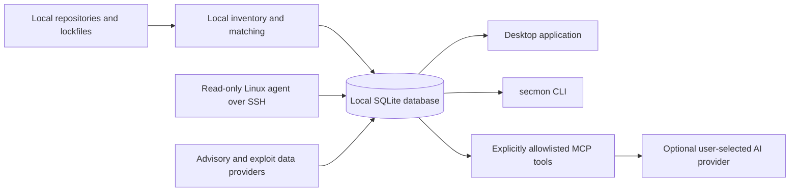

# Security Monitor

Security Monitor (`secmon`) is an open-source project to connect software vulnerability advisories with evidence from local projects and deployed environments in a local-first workflow.

> **Current state:** this repository is under active development. It contains typed Rust/SQLite foundations, dependency inventory, advisory-provider, scanner-adapter, finding-correlation, orchestration, and notification libraries. The Tauri shell and CLI do not yet invoke these libraries or present scan results. Do not use the current build as an end-user security scanner or as evidence that a system is safe.

## Implemented today

- Cargo and pnpm workspaces with cross-platform CI.
- Rust domain types, SQLite migrations, typed repositories, and generated TypeScript contracts.
- A local inventory library for supported lockfiles, monorepo discovery, Dockerfile/workflow detection, and PURL generation.
- An advisory library for incremental cve.now records, offline OSV archives, GHSA cross-checks, CISA KEV, FIRST EPSS, source merging, cache freshness, and conservative local matching.
- A scanner adapter library for OSV-Scanner, Trivy, and Semgrep detection, offline invocation, pinned binary downloads, and output normalization.
- A correlation library for advisory alias merging, version-range matching, stable finding fingerprints, deterministic priority explanations, and evidence-gated status changes.
- A local scan orchestration library with a bounded queue, resource limits, quick/full profiles, a three-second file watcher debounce, startup hash checks, and cached-inventory advisory re-correlation.
- Notification transports for desktop, approved HTTPS webhooks/Slack/Discord, and TLS SMTP, with OS-keyring secrets, recorded destination approvals, deduplication, and snoozing.
- A versioned server inventory protocol, read-only root-free Linux collector, OS-keyring SSH pairing, forced-command restrictions, host-key pinning, SSH config discovery, and fixed-command agentless collection API.
- A Tauri desktop shell and the `secmon --help` / `secmon --version` CLI.

The scan, notification, and server collection libraries are not yet connected to the desktop app or CLI. AI, remediation, and product screens are not available.

## Roadmap

The remaining v1.0 work connects the implemented libraries to desktop/CLI management flows, adds AI/MCP, approved remediation, and reporting. Work proceeds milestone by milestone, and each feature will be described as it becomes available.

## How it compares

| Tool | Main focus | How Security Monitor relates |
| --- | --- | --- |
| [Dependabot](https://docs.github.com/en/code-security/concepts/supply-chain-security/dependabot-security-updates) | Alerts on vulnerable repository dependencies and can open security-update pull requests. | Security Monitor is not a dependency updater; its target is to connect local inventory with deployment evidence. |
| [Trivy](https://trivy.dev/docs/latest/) | Scans packages, images, secrets, and misconfigurations. | Security Monitor has a local Trivy adapter library; the current app does not invoke it. The product target also tracks repo-to-production evidence. |
| [OSV-Scanner](https://google.github.io/osv-scanner/) | Extracts project or image packages and matches them to OSV advisories. | Security Monitor has inventory, advisory, and scanner adapter libraries; the current app does not invoke them. |

Security Monitor aims to connect local project inventory with read-only deployment evidence, advisory provenance, and user-controlled triage in one local workflow. Inventory, advisory, scanner-adapter, correlation, and orchestration libraries now exist, but the end-user workflow that connects them to deployment evidence and the UI is not implemented yet.

## Planned architecture



The diagram describes the target product architecture. Inventory, advisory provider, scanner adapter, correlation, orchestration, and Linux agent/SSH libraries are implemented. Their user workflows, MCP tools, and functional monitoring UI are not implemented yet.

## Privacy

The current desktop shell and CLI do not run scans or make runtime network requests. The SSH transport library connects only when called with a user-selected target, confirmed host-key fingerprint, and timestamped inventory approval returned to the caller for audit recording. The remote agent returns inventory over that SSH connection; it does not send it to a third party. Agentless collection requires explicit approval and runs only its compile-time command list. The scanner adapter library runs tools offline; pinned binary downloads require caller approval and `public_downloads_enabled`. The advisory library can download public data only when its caller explicitly enables `public_downloads_enabled`. Its requests do not contain source code, lockfiles, package names, or package versions. An OSV archive request includes the selected ecosystem in its URL, which reveals that coarse ecosystem to OSV; cve.now filtered feeds that would disclose inventory-derived filters are not used. Provider caches stay local. AI integration is not implemented. See [Privacy](docs/privacy.md) and [Scanner adapters](docs/scanners.md) for details.

## Quick start

### Desktop shell (development)

Install Rust, Node.js 22 or newer, pnpm 10.27.0, and the native prerequisites listed in the [Tauri guide](https://v2.tauri.app/start/prerequisites/). Then run:

```text
pnpm install --frozen-lockfile
pnpm -C apps/desktop tauri dev
```

This launches the current desktop shell; project monitoring screens are not implemented yet.

### CLI

Install the Rust toolchain from `rust-toolchain.toml`, then run:

```text
cargo run -p secmon -- --help
cargo run -p secmon -- --version
```

The current CLI only provides its version and help output. Scan and management commands are planned.

### Linux agent

The read-only Linux server agent and SSH transport libraries are implemented, but the desktop pairing workflow is not connected. See [Linux agent installation](docs/agent-install.md) for the checksum-verified installer and the direct-host developer harness.

### AI providers

AI provider integration is not implemented yet. See [AI providers](docs/ai-providers.md) for the planned privacy and approval model.

## Data sources and attribution

The provider library supports public advisory downloads, but the current application and CLI do not invoke it. Supported sources, freshness rules, and current attributions are documented in [Data sources](docs/data-sources.md). When displaying cve.now summaries, attribute [cve.now](https://cve.now/) under [CC BY 4.0](https://creativecommons.org/licenses/by/4.0/). Data combined by cve.now may have separate source terms. For NVD-derived data, display: “This product uses data from the NVD API but is not endorsed or certified by the NVD.” Missing, stale, or unverified data must not be treated as a clean result.

## Documentation

- [Architecture](docs/architecture.md)
- [Scanner adapters](docs/scanners.md)
- [Finding correlation](docs/correlation.md)
- [Scan orchestration and notifications](docs/orchestration.md)
- [Threat model](docs/threat-model.md)
- [Privacy](docs/privacy.md)
- [Data sources](docs/data-sources.md)
- [Linux agent installation](docs/agent-install.md)
- [Deploy ID](docs/deploy-id.md)
- [AI providers](docs/ai-providers.md)
- [CLI](docs/cli.md)
- [Contributing](docs/contributing.md)

The documentation site source is in [`docs/site`](docs/site). A GitHub Pages workflow builds it and deploys only when Pages is enabled by a repository maintainer.

## Contributing

Read [CONTRIBUTING.md](CONTRIBUTING.md) and [docs/contributing.md](docs/contributing.md) before making changes. Please use the issue forms for bugs, feature requests, and false-positive reports. Security vulnerabilities should be reported through the private process in [SECURITY.md](SECURITY.md), not a public issue.

## Security

See [SECURITY.md](SECURITY.md) for supported-version policy and private vulnerability reporting.

## License

Security Monitor source code is licensed under Apache-2.0. See [LICENSE](LICENSE). Third-party vulnerability and advisory data retain their own source licenses and terms.

## Disclaimer

Security Monitor is provided for informational purposes. A missing finding is not proof that software or an environment is secure. Verify results against the original advisory and your own environment before making security decisions.
