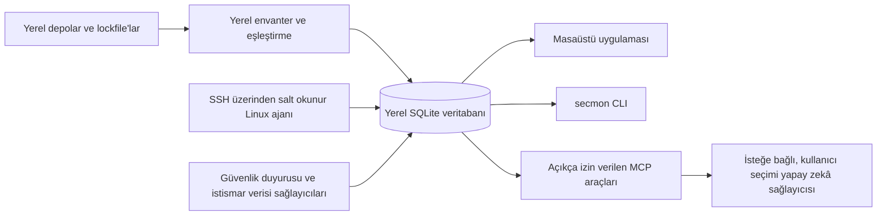

# Security Monitor

Security Monitor (`secmon`), yazılım güvenlik duyurularını yerel projeler ve dağıtılmış ortam kanıtlarıyla yerel öncelikli bir iş akışında birleştirmeyi amaçlayan açık kaynaklı bir projedir.

> **Mevcut durum:** depo geliştirme aşamasındadır. Tür güvenli Rust/SQLite temeli, bağımlılık envanteri kitaplığı ve belirlenimci eşleştirme ile yerel önbellekler içeren advisory sağlayıcı kitaplığı bulunur. Tauri kabuğu ve CLI henüz bu kitaplıkları çağırmaz veya tarama sonucu göstermez. Mevcut derlemeyi kullanıcıya yönelik bir güvenlik tarayıcısı ya da sistemin güvenli olduğuna dair kanıt olarak kullanmayın.

## Bugün uygulananlar

- Çapraz platform CI içeren Cargo ve pnpm çalışma alanları.
- Rust alan türleri, SQLite migration'ları, tür güvenli repository'ler ve üretilmiş TypeScript sözleşmeleri.
- Desteklenen lockfile'lar, monorepo keşfi, Dockerfile/workflow algılama ve PURL üretimi için yerel envanter kitaplığı.
- Artımlı cve.now kayıtları, çevrimdışı OSV arşivleri, GHSA çapraz kontrolü, CISA KEV, FIRST EPSS, kaynak birleştirme, önbellek güncelliği ve tutucu yerel eşleştirme için advisory kitaplığı.
- Tauri masaüstü kabuğu ve `secmon --help` / `secmon --version` CLI komutları.

Bu kitaplıklar henüz masaüstü veya CLI içinde proje tarama iş akışına bağlanmadı. Sunucu toplama, tarayıcı çalıştırma, bulgu korelasyonu, yapay zekâ, düzeltme ve ürün ekranları kullanıma hazır değildir.

## Yol haritası

Kalan v1.0 kapsamı tarayıcı adaptörleri, bulgu korelasyonu ve yaşam döngüsü, orkestrasyon, SSH üzerinden salt okunur Linux toplama, AI/MCP, onaylı düzeltme, raporlama ve kullanılabilir masaüstü/CLI yönetim iş akışlarıdır. İş milestone'lar halinde ilerler; özellikler kullanılabilir oldukça belgelenir.

## Yaklaşımın karşılaştırması

| Araç | Temel odak | Security Monitor ile ilişkisi |
| --- | --- | --- |
| [Dependabot](https://docs.github.com/en/code-security/concepts/supply-chain-security/dependabot-security-updates) | Depo bağımlılıklarındaki açıklara uyarı verir ve güvenlik güncelleme pull request'leri açabilir. | Security Monitor bir bağımlılık güncelleyici değildir; hedefi yerel envanteri dağıtım kanıtlarıyla ilişkilendirmektir. |
| [Trivy](https://trivy.dev/docs/latest/) | Paketleri, imajları, secret'ları ve yanlış yapılandırmaları tarar. | Trivy, Security Monitor'ın uyarlamayı planladığı tarayıcılardandır; ürün hedefi ayrıca repo ile production kanıtını ilişkilendirir. |
| [OSV-Scanner](https://google.github.io/osv-scanner/) | Proje veya imaj paketlerini çıkarıp OSV duyurularıyla eşleştirir. | Security Monitor envanter/advisory kitaplığı içerir; tarayıcı entegrasyonu henüz yol haritasındadır. |

Security Monitor'ın hedefi yerel proje envanterini salt okunur dağıtım kanıtları, duyuru kaynakları ve kullanıcı denetimindeki incelemeyle aynı yerel iş akışında birleştirmektir. Envanter ve advisory kitaplıkları vardır; ancak bunları tarayıcılara, dağıtım kanıtlarına ve arayüze bağlayan kullanıcı iş akışı henüz uygulanmadı.

## Hedef mimari



Bu diyagram hedef mimariyi gösterir. Envanter ve advisory sağlayıcı kitaplıkları uygulanmıştır; ancak Linux ajanı, tarayıcı entegrasyonu, orkestrasyon, MCP araçları ve işlevsel arayüz henüz uygulanmadı.

## Gizlilik

Mevcut masaüstü kabuğu ve CLI tarama yapmaz veya çalışma sırasında ağ isteği göndermez. Advisory kitaplığı kamuya açık verileri yalnızca çağıran kod `public_downloads_enabled` seçeneğini açıkça etkinleştirirse indirir. İstekler kaynak kodu, lockfile, paket adı veya paket sürümü içermez. OSV arşivi isteğinin URL'sinde ekosistem adı bulunur; bu, OSV'ye ekosistem hakkında sınırlı bilgi verir. Envanterden türetilen filtreleri açığa çıkaracak cve.now filtreli akışları kullanılmaz. Sağlayıcı önbellekleri yereldir; AI entegrasyonu uygulanmadı. Ayrıntılar için [Gizlilik](docs/privacy.md) belgesine bakın.

## Hızlı başlangıç

### Masaüstü kabuğu (geliştirme)

Rust, Node.js 22 veya üzeri, pnpm 10.27.0 ve [Tauri önkoşullarını](https://v2.tauri.app/start/prerequisites/) kurun:

```text
pnpm install --frozen-lockfile
pnpm -C apps/desktop tauri dev
```

Bu komut mevcut masaüstü kabuğunu açar; proje izleme ekranları henüz uygulanmadı.

### CLI

`rust-toolchain.toml` dosyasındaki Rust araç zincirini kurup çalıştırın:

```text
cargo run -p secmon -- --help
cargo run -p secmon -- --version
```

Mevcut CLI yalnızca yardım ve sürüm bilgisini verir. Tarama ve yönetim komutları yol haritasındadır.

### Linux ajanı ve yapay zekâ

Salt okunur Linux sunucu ajanı ve yapay zekâ sağlayıcı entegrasyonu henüz uygulanmadı. Tasarlanan sınırlar için [ajan kurulum](docs/agent-install.md) ve [yapay zekâ sağlayıcıları](docs/ai-providers.md) belgelerine bakın; bu sürümde kurulum komutu yoktur.

## Güvenlik verisi ve kaynak gösterimi

Sağlayıcı kitaplığı kamuya açık güvenlik duyurusu verilerini indirebilir; ancak mevcut masaüstü uygulaması ve CLI bu kitaplığı çağırmaz. Kullanılan kaynaklar, güncellik kuralları ve atıflar [Veri kaynakları](docs/data-sources.md) belgesindedir. cve.now özeti gösterildiğinde [cve.now](https://cve.now/) atfı ve [CC BY 4.0](https://creativecommons.org/licenses/by/4.0/) lisans bağlantısı verilmelidir. cve.now tarafından birleştirilen diğer veriler farklı kaynak koşullarına tabi olabilir. NVD verisi kullanıldığında şu bildirim gösterilmelidir: “This product uses data from the NVD API but is not endorsed or certified by the NVD.” Eksik, eski veya doğrulanmamış veri temiz sonuç sayılmamalıdır.

## Belgeler

- [Mimari](docs/architecture.md)
- [Tehdit modeli](docs/threat-model.md)
- [Gizlilik](docs/privacy.md)
- [Veri kaynakları](docs/data-sources.md)
- [Linux ajan kurulumu](docs/agent-install.md)
- [Deploy ID](docs/deploy-id.md)
- [Yapay zekâ sağlayıcıları](docs/ai-providers.md)
- [CLI](docs/cli.md)
- [Katkıda bulunma](CONTRIBUTING.md)

## Katkıda bulunma ve güvenlik

Değişiklik yapmadan önce [CONTRIBUTING.md](CONTRIBUTING.md) dosyasını okuyun. Güvenlik açıklarını herkese açık issue olarak değil, [SECURITY.md](SECURITY.md) belgesindeki özel bildirim yöntemiyle iletin.

## Lisans ve sorumluluk reddi

Security Monitor kaynak kodu Apache-2.0 lisanslıdır; ayrıntılar [LICENSE](LICENSE) dosyasındadır. Üçüncü taraf güvenlik verileri kendi lisans ve koşullarını korur. Eksik bulgu, yazılımın veya ortamın güvenli olduğunun kanıtı değildir. Sonuçları güvenlik kararı vermeden önce özgün duyurular ve kendi ortamınızla doğrulayın.
