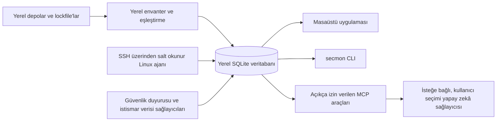

# Security Monitor

Security Monitor (`secmon`), yazılım projeleri ve dağıtılmış ortamlar için yerel öncelikli, açık kaynaklı bir güvenlik izleme ürünüdür. Hedefi, bağımlılık güvenlik duyurularını dağıtım kanıtlarıyla aynı yerel iş akışında birleştirmektir. Kaynak kodu, lockfile'lar ve envanter varsayılan olarak kullanıcının cihazında kalmalıdır.

> **Mevcut durum:** depo geliştirme aşamasındadır. Şu an Rust çalışma alanı, tür güvenli çekirdek ve SQLite veri katmanı, masaüstü kabuğu ve sürüm bilgisini veren bir CLI bulunur. Bağımlılık envanteri, güvenlik açığı eşleştirme, tarayıcılar, ajanlar, yapay zekâ iş akışları ve ürün arayüzü yol haritasındadır. Mevcut derlemeyi güvenlik tarayıcısı veya sistemin güvenli olduğuna dair kanıt olarak kullanmayın.

## Bugün uygulananlar

- Çapraz platform CI içeren Cargo ve pnpm çalışma alanları.
- Rust alan türleri, SQLite migration'ları, tür güvenli repository'ler ve üretilmiş TypeScript sözleşmeleri.
- Tauri masaüstü kabuğu ve `secmon --help` / `secmon --version` CLI komutları.

Bunlar mühendislik temelidir; henüz bir projeyi veya üretim ortamını izlemez.

## Yol haritası

Planlanan v1.0 kapsamı yerel envanter ayrıştırma, güvenlik duyurusu eşleştirme ve kaynak izlenebilirliği, tarayıcı adaptörleri, bulgu korelasyonu, SSH üzerinden salt okunur Linux toplama, isteğe bağlı onaylı yapay zekâ iş akışları ve kullanılabilir masaüstü/CLI yönetim akışları ekler. İş milestone'lar halinde ilerler; özellikler kullanılabilir oldukça belgelenir.

## Yaklaşımın karşılaştırması

Bağımlılık güncelleme botları sürüm değişikliği önermeye, lockfile tarayıcıları bilinen güvenlik açıklarını paket sürümleriyle eşleştirmeye, konteyner ve sunucu tarayıcıları dağıtılmış yazılımı veya yapılandırmayı incelemeye odaklanır. Security Monitor'ın hedefi yerel proje envanterini salt okunur dağıtım kanıtları, duyuru kaynakları ve kullanıcı denetimindeki incelemeyle aynı iş akışında birleştirmektir. Bu entegrasyon henüz uygulanmadı; mevcut işlevler yukarıdaki mühendislik temeliyle sınırlıdır.

## Hedef mimari



Bu diyagram mevcut özellikleri değil, hedef mimariyi gösterir. Linux ajanı, sağlayıcılar, eşleştirme motoru, MCP araçları ve işlevsel kullanıcı arayüzü henüz uygulanmadı.

## Gizlilik

Security Monitor proje kaynak kodunu, lockfile'ları ve envanteri varsayılan olarak yerel tutacak şekilde tasarlanıyor. Mevcut uygulama kabuğu ve CLI bunları yüklemez ve çalışma sırasında ağ isteği yapmaz. Gelecekteki sağlayıcı ve yapay zekâ özellikleri için [Gizlilik](docs/privacy.md) belgesindeki onay ve gizlilik kontrolleri uygulanmalıdır. Açıkça kaydedilmiş kullanıcı onayı olmadan kaynak kodu, lockfile veya envanter yüklenmesi planlanmıyor.

## Hızlı başlangıç

### Masaüstü kabuğu (geliştirme)

Rust, Node.js 22 veya üzeri, pnpm 10.27.0 ve [Tauri önkoşullarını](https://v2.tauri.app/start/prerequisites/) kurun:

```text
pnpm install --frozen-lockfile
pnpm -C apps/desktop tauri dev
```

Bu komut mevcut masaüstü kabuğunu açar; proje izleme ekranları henüz uygulanmadı.

### CLI

`rust-toolchain.toml` dosyasındaki Rust araç zincirini kurup çalıştırın:

```text
cargo run -p secmon -- --help
cargo run -p secmon -- --version
```

Mevcut CLI yalnızca yardım ve sürüm bilgisini verir. Tarama ve yönetim komutları yol haritasındadır.

### Linux ajanı ve yapay zekâ

Salt okunur Linux sunucu ajanı ve yapay zekâ sağlayıcı entegrasyonu henüz uygulanmadı. Tasarlanan sınırlar için [ajan kurulum](docs/agent-install.md) ve [yapay zekâ sağlayıcıları](docs/ai-providers.md) belgelerine bakın; bu sürümde kurulum komutu yoktur.

## Güvenlik verisi ve kaynak gösterimi

Mevcut uygulama güvenlik duyurusu verisi indirmez. Planlanan kaynaklar ve kullanım amaçları [Veri kaynakları](docs/data-sources.md) belgesinde açıklanmıştır. Eksik, eski veya doğrulanmamış veri temiz sonuç sayılmamalıdır.

Gelecekte cve.now özetleri gösterilirse bu özetler [CC BY 4.0](https://creativecommons.org/licenses/by/4.0/) kapsamında lisanslıdır ve [cve.now](https://cve.now/) atfı gerektirir. cve.now tarafından birleştirilen diğer veriler farklı kaynak koşullarına tabi olabilir. NVD verisi kullanıldığında şu bildirim eklenmelidir: “This product uses data from the NVD API but is not endorsed or certified by the NVD.”

## Belgeler

- [Mimari](docs/architecture.md)
- [Tehdit modeli](docs/threat-model.md)
- [Gizlilik](docs/privacy.md)
- [Veri kaynakları](docs/data-sources.md)
- [Linux ajan kurulumu](docs/agent-install.md)
- [Deploy ID](docs/deploy-id.md)
- [Yapay zekâ sağlayıcıları](docs/ai-providers.md)
- [CLI](docs/cli.md)
- [Katkıda bulunma](CONTRIBUTING.md)

## Katkıda bulunma ve güvenlik

Değişiklik yapmadan önce [CONTRIBUTING.md](CONTRIBUTING.md) dosyasını okuyun. Güvenlik açıklarını herkese açık issue olarak değil, [SECURITY.md](SECURITY.md) belgesindeki özel bildirim yöntemiyle iletin.

## Lisans ve sorumluluk reddi

Security Monitor kaynak kodu Apache-2.0 lisanslıdır; ayrıntılar [LICENSE](LICENSE) dosyasındadır. Üçüncü taraf güvenlik verileri kendi lisans ve koşullarını korur. Eksik bulgu, yazılımın veya ortamın güvenli olduğunun kanıtı değildir. Sonuçları güvenlik kararı vermeden önce özgün duyurular ve kendi ortamınızla doğrulayın.
