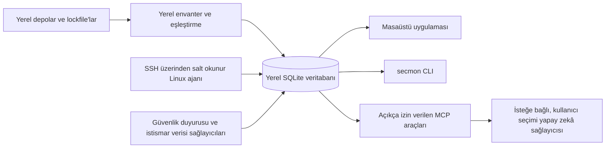

# Security Monitor

Security Monitor (`secmon`), yazılım güvenlik duyurularını yerel projeler ve dağıtılmış ortam kanıtlarıyla yerel öncelikli bir iş akışında birleştirmeyi amaçlayan açık kaynaklı bir projedir.

> **Mevcut durum:** depo geliştirme aşamasındadır. Tür güvenli Rust/SQLite temeli, bağımlılık envanteri, advisory sağlayıcı, tarayıcı adaptörü, bulgu korelasyonu, repo-production drift, orkestrasyon, bildirim, Linux ajanı/SSH, masaüstü inceleme akışları ve kullanıcı onaylı AI/MCP desteği bulunur. Eksik, eski veya doğrulanmamış kanıt temiz ya da güvenli sonuç sayılmaz.

## Bugün uygulananlar

- Çapraz platform CI içeren Cargo ve pnpm çalışma alanları.
- Rust alan türleri, SQLite migration'ları, tür güvenli repository'ler ve üretilmiş TypeScript sözleşmeleri.
- Desteklenen lockfile'lar, monorepo keşfi, Dockerfile/workflow algılama ve PURL üretimi için yerel envanter kitaplığı.
- Artımlı cve.now kayıtları, çevrimdışı OSV arşivleri, GHSA çapraz kontrolü, CISA KEV, FIRST EPSS, kaynak birleştirme, önbellek güncelliği ve tutucu yerel eşleştirme için advisory kitaplığı.
- OSV-Scanner, Trivy ve Semgrep algılama, onaylı sabit sürümlü indirme, çevrimdışı çalıştırma ve çıktı normalleştirme için tarayıcı adaptörü; ayrıca yerel bulgu korelasyonu.
- Mevcut bulguları doğrulanmış referans dalı ve dağıtım envanterleriyle karşılaştıran; çalışma kopyasındaki commit edilmemiş değişiklikleri ayrı tutan ve düzeltme için güncel, eksiksiz kanıt isteyen drift kitaplığı.
- Sınırlı kuyruk, kaynak kotaları, hızlı/tam profiller, üç saniyelik dosya izleyici gecikmesi, başlangıç hash kontrolü ve önbellekteki envanterle advisory yeniden eşleştirme içeren orkestrasyon kitaplığı.
- Masaüstü, kullanıcı onaylı HTTPS webhook/Slack/Discord ve TLS SMTP bildirimleri; sırlar OS anahtarlığında tutulur, hedef onayı kaydedilir, tekilleştirme ve erteleme desteklenir.
- Sürümlemeli sunucu envanter protokolü, salt okunur ve root gerektirmeyen Linux ajanı, OS anahtarlığında SSH eşleştirme anahtarı, zorunlu komut kısıtlamaları, host-key sabitleme, SSH yapılandırmasından host keşfi ve sabit komutlu ajansız toplama API'si.
- Tauri masaüstü uygulaması: proje ekleme/tarama, bulgu inceleme, sunucu eşleştirme ve envanter onayı, AI sağlayıcı ayarları, redakte istem incelemesi, bütçe sınırları ve yerel MCP sunucusu.
- `secmon --help`, `secmon --version` ve salt okunur veritabanıyla çalışan `secmon mcp` CLI komutları.
- Linux sunucu envanterinde çalışan/kurulu kernel farkı, silinmiş paylaşımlı kütüphaneleri kullanan süreçler ve `/opt` ile `/usr/local` altındaki izinli manuel binary'ler görünür; eksik veya tanınmayan kanıt kısmi/doğrulanmamış kalır.
- RSS/Atom güvenlik haberleri ürün adıyla yerel eşleştirilir, bulgulardan ayrı gösterilir ve yalnızca tam CVE/GHSA kimliği geldiğinde advisory'ye bağlanır; tek başına zafiyet bulgusu üretmez.
- Düzeltme istekleri onaylı izole Git worktree'lerinde hazırlanır; testler ağ kapalı sandbox içinde ve kullanıcı onayıyla çalışır.

Rapor biçimleri, `secmon hook`, `secmon integrate` ve ajanlar arası ortak hafıza yol haritasındadır. Uygulama geliştirme aşamasındadır; mevcut derlemeyi tam güvenlik kapsamının kanıtı olarak kullanmayın.

## Yol haritası

Kalan v1.0 kapsamı bu kitaplıkları masaüstü/CLI yönetim akışlarına bağlama, AI/MCP, onaylı düzeltme ve raporlamadır. İş milestone'lar halinde ilerler; özellikler kullanılabilir oldukça belgelenir.

## Yaklaşımın karşılaştırması

| Araç | Temel odak | Security Monitor ile ilişkisi |
| --- | --- | --- |
| [Dependabot](https://docs.github.com/en/code-security/concepts/supply-chain-security/dependabot-security-updates) | Depo bağımlılıklarındaki açıklara uyarı verir ve güvenlik güncelleme pull request'leri açabilir. | Security Monitor bir bağımlılık güncelleyici değildir; hedefi yerel envanteri dağıtım kanıtlarıyla ilişkilendirmektir. |
| [Trivy](https://trivy.dev/docs/latest/) | Paketleri, imajları, secret'ları ve yanlış yapılandırmaları tarar. | Security Monitor'da Trivy adaptör kitaplığı vardır; mevcut uygulama henüz bu adaptörü çağırmaz. Ürün hedefi ayrıca repo ile production kanıtını ilişkilendirir. |
| [OSV-Scanner](https://google.github.io/osv-scanner/) | Proje veya imaj paketlerini çıkarıp OSV duyurularıyla eşleştirir. | Security Monitor'da envanter, advisory ve tarayıcı adaptör kitaplıkları vardır; mevcut uygulama henüz bunları çağırmaz. |

Security Monitor'ın hedefi yerel proje envanterini salt okunur dağıtım kanıtları, duyuru kaynakları ve kullanıcı denetimindeki incelemeyle aynı yerel iş akışında birleştirmektir. Envanter, advisory, tarayıcı adaptörü, korelasyon ve orkestrasyon kitaplıkları vardır; ancak bunları dağıtım kanıtlarına ve arayüze bağlayan kullanıcı iş akışı henüz uygulanmadı.

## Hedef mimari



Masaüstü uygulaması yerel iş akışlarını ve MCP araç izinlerini sunar. AI sağlayıcıya istek göndermeden önce redakte edilmiş istem, hedef, veri kategorisi, araçlar ve maliyet üst sınırı kullanıcıya gösterilir.

## Gizlilik

Tarayıcılar yerelde çalışır; kamuya açık advisory güncellemeleri kullanıcı ayarına ve açık eyleme bağlıdır. AI istekleri ortak HTTP sarmalayıcısını kullanır, yönlendirmeleri izlemez ve yalnızca inceleme/onaydan sonra gönderilir. Kaynak dosya araçları varsayılan olarak kapalıdır; CLI MCP üzerinden kaynak okumak için proje başına ayrı ve denetim günlüğüne kaydedilen onay gerekir. Sırlar yalnızca işletim sistemi anahtarlığında tutulur. Ayrıntılar için [Gizlilik](docs/privacy.md), [AI sağlayıcıları](docs/ai-providers.md) ve [Yerel MCP](docs/local-mcp.md) belgelerine bakın.

## Hızlı başlangıç

### Masaüstü kabuğu (geliştirme)

Rust, Node.js 22 veya üzeri, pnpm 10.27.0 ve [Tauri önkoşullarını](https://v2.tauri.app/start/prerequisites/) kurun:

```text
pnpm install --frozen-lockfile
pnpm -C apps/desktop tauri dev
```

Bu komut mevcut masaüstü kabuğunu açar; proje izleme ekranları henüz uygulanmadı.

### CLI

`rust-toolchain.toml` dosyasındaki Rust araç zincirini kurup çalıştırın:

```text
cargo run -p secmon -- --help
cargo run -p secmon -- --version
cargo run -p secmon -- mcp
```

`secmon mcp`, mevcut SQLite veritabanını salt okunur açıp yalnızca AI ayarlarında etkin araçları stdio üzerinden sunar. Ayrıntılar için [Yerel MCP](docs/local-mcp.md) belgesine bakın.

### Linux ajanı

Salt okunur Linux sunucu ajanı masaüstünden SSH ile eşleştirilip ayrıca onaylanan envanter toplamaları için kullanılabilir. Linux'ta derleyip checksum'ı doğrulayın:

```text
rustup target add x86_64-unknown-linux-musl
cargo build -p secmon-agent --release --target x86_64-unknown-linux-musl
sha256sum target/x86_64-unknown-linux-musl/release/secmon-agent
sudo ./install.sh --binary target/x86_64-unknown-linux-musl/release/secmon-agent --sha256 <verified-sha256>
```

Host-key parmak izini bağımsız doğrulamadan ve envanter aktarımını gözden geçirmeden onaylamayın. Tam adımlar için [Linux ajan kurulumu](docs/agent-install.md) belgesine bakın.

### Yapay zekâ

OpenAI-compatible HTTPS, Anthropic ve loopback yerel sağlayıcılar kullanıcı tarafından yapılandırılır. Bütçeler varsayılan olarak sıfırdır; her istek redakte istemi, hedefi, araçları ve maliyet üst sınırını onay ekranında gösterir. [AI sağlayıcıları](docs/ai-providers.md) ve [Yerel MCP](docs/local-mcp.md) belgelerine bakın.

## Güvenlik verisi ve kaynak gösterimi

Sağlayıcı kitaplığı kamuya açık güvenlik duyurusu verilerini indirebilir; ancak mevcut masaüstü uygulaması ve CLI bu kitaplığı çağırmaz. Kullanılan kaynaklar, güncellik kuralları ve atıflar [Veri kaynakları](docs/data-sources.md) belgesindedir. cve.now özeti gösterildiğinde [cve.now](https://cve.now/) atfı ve [CC BY 4.0](https://creativecommons.org/licenses/by/4.0/) lisans bağlantısı verilmelidir. cve.now tarafından birleştirilen diğer veriler farklı kaynak koşullarına tabi olabilir. NVD verisi kullanıldığında şu bildirim gösterilmelidir: “This product uses data from the NVD API but is not endorsed or certified by the NVD.” Eksik, eski veya doğrulanmamış veri temiz sonuç sayılmamalıdır.

## Belgeler

- [Mimari](docs/architecture.md)
- [Tehdit modeli](docs/threat-model.md)
- [Gizlilik](docs/privacy.md)
- [Veri kaynakları](docs/data-sources.md)
- [Tarayıcı adaptörleri](docs/scanners.md)
- [Bulgu korelasyonu](docs/correlation.md)
- [Repo-production drift karşılaştırması](docs/drift.md)
- [Tarama orkestrasyonu ve bildirimler](docs/orchestration.md)
- [Linux ajan kurulumu](docs/agent-install.md)
- [Deploy ID](docs/deploy-id.md)
- [Yapay zekâ sağlayıcıları](docs/ai-providers.md)
- [Yerel MCP](docs/local-mcp.md)
- [CLI](docs/cli.md)
- [Katkıda bulunma](CONTRIBUTING.md)

## Katkıda bulunma ve güvenlik

Değişiklik yapmadan önce [CONTRIBUTING.md](CONTRIBUTING.md) dosyasını okuyun. Güvenlik açıklarını herkese açık issue olarak değil, [SECURITY.md](SECURITY.md) belgesindeki özel bildirim yöntemiyle iletin.

## Lisans ve sorumluluk reddi

Security Monitor kaynak kodu Apache-2.0 lisanslıdır; ayrıntılar [LICENSE](LICENSE) dosyasındadır. Üçüncü taraf güvenlik verileri kendi lisans ve koşullarını korur. Eksik bulgu, yazılımın veya ortamın güvenli olduğunun kanıtı değildir. Sonuçları güvenlik kararı vermeden önce özgün duyurular ve kendi ortamınızla doğrulayın.
