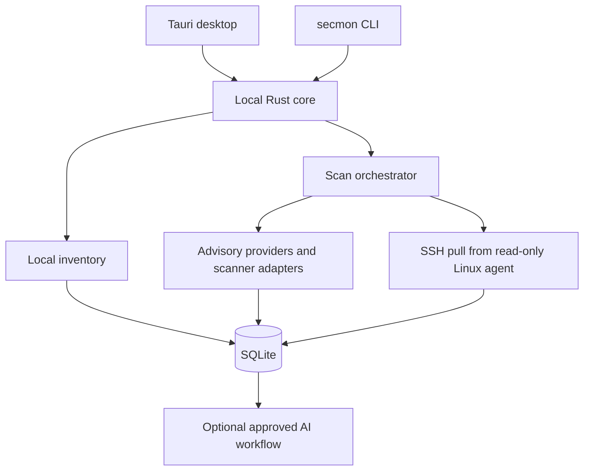

# Architecture

## Current implementation

The repository is a Rust Cargo workspace and pnpm workspace. `apps/desktop` contains a Tauri 2 + React shell, `apps/cli` contains the `secmon` binary, `crates/core` owns domain types, and `crates/database` owns SQLite migrations and typed repositories. The current CLI exposes help and version output. Inventory, advisory ingestion, scanner orchestration, findings, SSH collection, AI, and product workflows are not implemented yet.

## Target architecture

The target is a local application that stores project and deployment observations in SQLite, with the desktop app and CLI using shared Rust services. Repository inventory and lockfiles are parsed locally. Advisory feeds and scanner adapters populate normalized evidence through narrowly scoped provider crates. A read-only Linux agent may return a fixed inventory protocol over SSH. Optional AI receives only approved, redacted metadata and uses a restricted tool set.

This is the target, not a claim about current feature availability. Network-capable components must use the single HTTP client wrapper, record destination hosts, and honor privacy settings. Core must not depend on Tauri. All database access goes through `crates/database` repository functions.

## Trust boundaries

- Repository contents, lockfiles, scanner output, advisory text, model output, and remote agent output are untrusted data.
- Local project files, SQLite, OS credential storage, external data providers, SSH servers, and optional AI providers are separate trust zones.
- Project source, lockfiles, and inventory stay local unless the user explicitly records approval for a specific transfer.
- A server agent has no generic command execution path; it only exposes the compile-time allowlisted collection command.
- Missing or stale evidence is represented as unverified or `needs_review`, never as a safe result.
