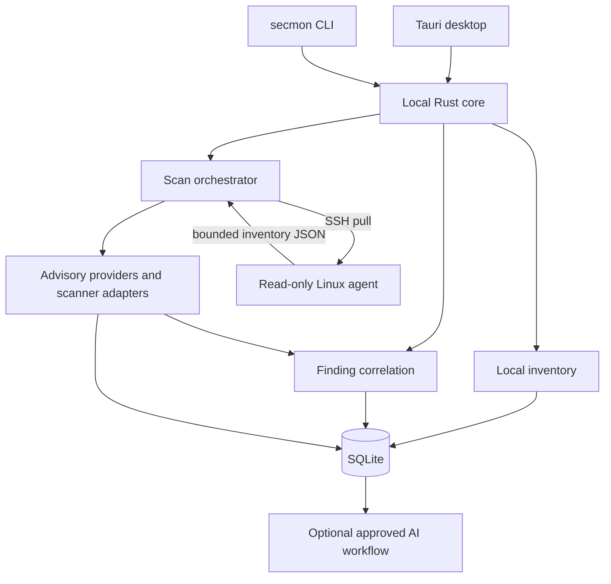

# Architecture

## Current implementation

The repository is a Rust Cargo workspace and pnpm workspace. `apps/desktop` contains the Tauri 2 + React application, and `apps/cli` contains the `secmon` binary for local scans, reports, advisory refresh, diagnostics, approved server collection, Git hooks, agent integrations, and the local MCP server. Rust libraries provide SQLite repositories and domain types (`core`, `database`), repository inventory (`inventory`), advisory ingestion and offline matching (`advisory-providers`), scanner process adapters (`scanner-adapters`), finding correlation (`correlation`), local scan orchestration with tray scheduling and file watching, and read-only Linux collection over pinned SSH (`agent-protocol`, `agent-transport`, `agents/linux`). The tray background routes finding, drift, and stale-server events through the notification crate; external channels are user-approved and their secrets stay in the OS credential store. The desktop and CLI share a local SQLite memory store for untrusted notes across supported coding agents. See the [feature status matrix](feature-status.md) for maturity and limits.

| Component | Responsibility |
| --- | --- |
| `crates/agent-protocol` | Versioned bounded inventory document and generated JSON Schema. |
| `crates/agent-transport` | Pinned SSH connections, dedicated key pairing, SSH config parsing, and local project association suggestions. Agentless collection is not available in the product. |
| `agents/linux` | Root-free Linux collection for OS packages, runtimes, processes, services, containers, selected lockfiles, and deployment identity. The desktop evaluates mapped Debian, Ubuntu, AlmaLinux, Rocky Linux, Red Hat, and Alpine OSV ecosystems; ambiguous or missing source data stays unverified. |

## Current data flow

The desktop app and CLI use shared Rust services and store project and deployment observations in SQLite. Repository inventory and lockfiles are parsed locally. Advisory feeds and scanner adapters populate normalized evidence through narrowly scoped provider crates. The desktop pairs with a read-only Linux agent over pinned SSH and requires approval for each collection. Optional AI receives only approved, redacted metadata and uses a restricted tool set. Current maturity and limits are listed in the [feature status matrix](feature-status.md).

The desktop implements project management and Linux-agent pairing over pinned SSH; each server inventory collection requires user approval. Network-capable components use the single HTTP client wrapper, record destination hosts, and honor privacy settings. Core must not depend on Tauri. All database access goes through `crates/database` repository functions. Agentless SSH collection is not available in the desktop product.

## Trust boundaries

- Repository contents, lockfiles, scanner output, advisory text, model output, and remote agent output are untrusted data.
- Local project files, SQLite, OS credential storage, external data providers, SSH servers, and optional AI providers are separate trust zones.
- Project source, lockfiles, and inventory stay local unless the user explicitly records approval for a specific transfer.
- A server agent has no generic command execution path; it only exposes the compile-time allowlisted collection command.
- Missing or stale evidence is represented as unverified or `needs_review`, never as a safe result.
